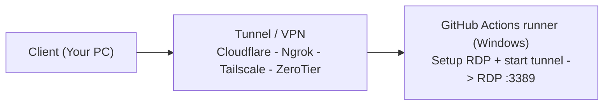

# Playground RDP - GitHub Actions Remote Desktop

Repository ini berisi workflow GitHub Actions untuk memberi akses Remote Desktop (RDP)
ke runner GitHub Actions menggunakan beberapa metode tunneling berbeda.

## 📋 Daftar Workflow

| Workflow | Metode Tunnel | OS Support | Setup | Status |
|----------|---------------|------------|-------|--------|
| `rdp-cloudflare.yml` | Cloudflare Tunnel | Windows only | Domain + tunnel token | ✅ legacy |
| `rdp-ngrok.yml` | Ngrok TCP | Windows only | Akun + authtoken | ✅ legacy |
| `rdp-tailscale.yml` | Tailscale (WireGuard) | Windows only | Akun + auth key | ✅ legacy |
| `rdp-zerotier.yml` | ZeroTier (mesh VPN) | Windows only | Akun + Network ID | ✅ baru |

> ⚠️ **Penting soal input `os`:** **semua** workflow di repo ini sekarang **Windows-only**.
> Step-nya memakai `shell: pwsh` + registry Windows (`HKLM:`, `New-LocalUser`, `netsh`).
> Input `os` masih ada, tetapi memilih `ubuntu-latest` / `macos-latest` akan **gagal**
> di step setup. Lihat [Pilih OS Runner](#pilih-os-runner-workflow-input).

### Memilih titik awal tercepat

| Kalau Anda… | Pakai |
|---|---|
| Sudah pakai Ngrok/Tailscale/Cloudflare (Windows) | workflow legacy-nya |
| Mau **VPN mesh** (akses langsung ke IP privat, tanpa port publik) | `rdp-zerotier.yml` atau `rdp-tailscale.yml` |

### 🔒 Catatan keamanan

Semua workflow ini membuat **akun Administrator dengan password acak** lalu mengeksposnya lewat
internet publik. Itu inherent pada konsepnya. Yang bisa dilakukan:

- Hapus log run setelah selesai — log berisi password / private key
- Batasi waktu sesi — jangan biarkan workflow menyala lebih lama dari yang dibutuhkan
- Jangan pernah simpan kredensial penting di runner yang diakses lewat tunnel ini

---

## 🔧 Prasyarat Umum

1. **GitHub Repository** dengan Actions enabled
2. **GitHub Secrets** sesuai metode yang dipilih (lihat tabel di bawah)
3. **Local machine** dengan Windows/Mac/Linux untuk koneksi RDP

---

## ☁️ 1. Cloudflare Tunnel (`rdp-cloudflare.yml`)

### Fitur
- Menggunakan Cloudflare Zero Trust Tunnel
- Support custom domain (misal: `rdp.domain.com`)
- Gratis untuk personal use
- Proteksi DDoS bawaan Cloudflare
- Bypass firewall/NAT tanpa port forwarding

### Persiapan (Sekali Saja)

#### A. Dapatkan Domain Gratis (digitalplat.org) + Setup Cloudflare
> **Catatan**: Cloudflare Tunnel memerlukan domain sendiri. Jika belum punya, bisa dapatkan gratis via [digitalplat.org](https://digitalplat.org/) lalu kelola DNS di Cloudflare.

1. **Daftar domain gratis di digitalplat.org**
   - Buka https://digitalplat.org/
   - Pilih menu **Domain** → submenu **Register Domains**
   - Pada halaman **Domain Registration**, pilih **DigitalPlat One** → klik **Choose a DigitalPlat extension**
   - Scroll ke bagian bawah
   - Ketik domain yang diinginkan, pilih ekstensi domain gratis yang disediakan → klik **Check Availability**
   - Jika tersedia, centang kebijakan → klik **Buat Domain**
   - Verifikasi email
   - Catat nameserver Cloudflare yang diberikan (biasanya 2 nameserver: `xxx.ns.cloudflare.com`, `yyy.ns.cloudflare.com`)

2. **Tambahkan domain ke Cloudflare**
   - Login ke [Cloudflare Dashboard](https://dash.cloudflare.com/)
   - Klik **Add a site** → Masukkan domain digitalplat.org Anda → **Continue**
   - Pilih plan **Free** → **Continue**
   - Cloudflare akan scan DNS record → **Continue**

3. **Ganti Nameserver di digitalplat.org**
   - Di Cloudflare, catat 2 nameserver (contoh: `alice.ns.cloudflare.com`, `bob.ns.cloudflare.com`)
   - Login ke digitalplat.org → Kelola Domain → **Ganti Nameserver**
   - Masukkan 2 nameserver Cloudflare → **Simpan**
   - Tunggu propagasi DNS (biasanya 5-30 menit, cek di Cloudflare status jadi **Active**)

4. **Verifikasi domain aktif di Cloudflare**
   - Di Cloudflare Dashboard, domain harus status **Active**
   - Tab **DNS** → **Records** → pastikan sudah ada record NS ke Cloudflare

#### B. Buat Cloudflare Tunnel
1. Login ke [Cloudflare Zero Trust Dashboard](https://one.dash.cloudflare.com/)
2. Pilih **Networks** → **Tunnels** → **Create a tunnel**
3. Pilih **Cloudflared** → Beri nama (misal: `github-rdp`)
4. **Save tunnel**

#### C. Konfigurasi Public Hostname (TCP)
1. Di halaman edit tunnel tersebut, lihat bagian atas dan klik tab **Public Hostname**.
2. Klik tombol **Add a public hostname**.
3. Isi kolom yang tersedia dengan data berikut:
   - **Subdomain**: `rdp`
   - **Domain**: Pilih domain digitalplat.org Anda dari menu drop-down
   - **Type** (di bawah kolom Service): pilih **TCP**
   - **URL**: `rdp://localhost:3389`
4. Klik **Save hostname**

#### D. Ambil Tunnel Token
1. Di detail tunnel, klik **Configure** → **Token**
2. Copy **Tunnel Token** (format: `eyJh...`)

### Setup GitHub Secrets
| Secret Name | Value | Deskripsi |
|-------------|-------|-----------|
| `CLOUDFLARE_TUNNEL_TOKEN` | Token dari langkah D | Untuk autentikasi tunnel |

### Menjalankan Workflow
1. Buka tab **Actions** di repository GitHub
2. Pilih **"Playground RDP (Cloudflare Tunnel)"** workflow
3. Klik **Run workflow** → isi **Tunnel hostname** (opsional, contoh: `rdp.namaku.digitalplat.org`) → **Run workflow**
4. Tunggu sampai step "Display RDP Access Info" muncul
5. Copy **Password** dari log

### Koneksi dari Local (Client)

#### Windows/macOS/Linux
```bash
# Install cloudflared
# Windows: winget install Cloudflare.cloudflared
# macOS: brew install cloudflare/cloudflare/cloudflared
# Linux: lihat https://developers.cloudflare.com/cloudflare-one/connections/connect-networks/downloads/

# Jalankan tunnel lokal (ganti dengan hostname Anda)
cloudflared access tcp --hostname rdp.namaku.digitalplat.org --url rdp://localhost:3389
```

#### Remote Desktop Connection
- **Computer**: `localhost:3389`
- **Username**: `RDP`
- **Password**: (dari log workflow)

> ⚠️ **Catatan**: Biarkan terminal `cloudflared` terbuka selama sesi RDP aktif.

---

## 🚀 2. Ngrok (`rdp-ngrok.yml`)

### Fitur
- Setup paling cepat (< 2 menit)
- URL TCP publik langsung (format: `0.tcp.ngrok.io:XXXXX`)
- Gratis untuk personal use (dengan batasan session)
- Tidak perlu custom domain

### Persiapan (Sekali Saja)

#### A. Buat Akun Ngrok
1. Daftar di [ngrok.com](https://ngrok.com/)
2. Verifikasi email
3. Buka **Dashboard** → **Your Authtoken**
4. Copy **Authtoken** (format: `2x...`)

### Setup GitHub Secrets
| Secret Name | Value | Deskripsi |
|-------------|-------|-----------|
| `NGROK_AUTH_TOKEN` | Authtoken dari dashboard Ngrok | Untuk autentikasi ngrok |

### Menjalankan Workflow
1. Buka tab **Actions** → **"playground"** workflow
2. Klik **Run workflow** → **Run workflow**
3. Tunggu step **"Install & Run Ngrok"** selesai
4. Lihat log step tersebut untuk mendapatkan **Public URL** (format: `0.tcp.ngrok.io:12345`)
5. Password default: `MantapBener_2026!`

### Koneksi dari Local (Client)
- **Computer**: `0.tcp.ngrok.io:XXXXX` (dari log workflow)
- **Username**: `RDP`
- **Password**: `MantapBener_2026!`

> ⚠️ **Catatan**: URL berubah setiap kali workflow dijalankan. Copy dari log terbaru.

---

## 🔐 3. Tailscale (`rdp-tailscale.yml`)

### Fitur
- Menggunakan WireGuard (performa tinggi, latency rendah)
- Mesh VPN - akses langsung via IP Tailscale (100.x.x.x)
- Tidak perlu port forwarding atau public IP
- Akses aman hanya untuk device di tailnet yang sama
- Gratis hingga 100 devices (Personal plan)

### Persiapan (Sekali Saja)

#### A. Buat Akun Tailscale
1. Daftar di [tailscale.com](https://tailscale.com/)
2. Login ke [Admin Console](https://login.tailscale.com/admin)

#### B. Buat Auth Key
1. **Settings** → **Auth keys** → **Generate auth key**
2. Pilih:
   - **Reusable** ✓ (agar bisa dipakai berulang)
   - **Ephemeral** ✓ (device otomatis hapus saat disconnected)
   - **Pre-approved** ✓ (langsung connect tanpa approval manual)
3. **Generate** → Copy key (format: `tskey-auth-...`)

### Setup GitHub Secrets
| Secret Name | Value | Deskripsi |
|-------------|-------|-----------|
| `TAILSCALE_AUTH_KEY` | Auth key dari langkah B | Untuk join tailnet |

### Menjalankan Workflow
1. Buka tab **Actions** → **"Playground RDP Tailscale"** workflow
2. Klik **Run workflow** → **Run workflow**
3. Tunggu step **"Establish Tailscale Connection"** selesai
3. Lihat log untuk **Tailscale IP** (format: `100.x.x.x`)
4. Copy **Password** dari step "Display RDP Access Info"

### Koneksi dari Local (Client)

#### Install Tailscale
- **Windows**: https://tailscale.com/download/windows
- **macOS**: https://tailscale.com/download/mac
- **Linux**: `curl -fsSL https://tailscale.com/install.sh | sh`
- **iOS/Android**: App Store / Play Store

#### Login & Connect
1. Buka Tailscale app → **Login** dengan akun yang sama
2. Tunggu status **Connected** (hijau)
3. Catat IP GitHub Runner dari log workflow (misal: `100.64.1.23`)

#### Remote Desktop Connection
- **Computer**: `100.x.x.x:3389` (IP Tailscale dari log)
- **Username**: `RDP`
- **Password**: (dari log workflow)

---

## 🪐 4. ZeroTier (`rdp-zerotier.yml`)

> Workflow **paling baru**, dan satu-satunya yang punya step cleanup yang proper
> (`zerotier-cli leave` jalan saat workflow cancelled/failed).
>
> ⚠️ Sejak ditulis ulang agar seragam dengan workflow lain, workflow ini **Windows-only**
> dan memakai step inline `pwsh` (bukan lagi composite action).

### Fitur
- Mesh VPN alternatif dari Tailscale (layer berbeda, jadi cadangan bila Tailscale bermasalah)
- Gratis untuk personal, tanpa kartu kredit
- **Windows only** — inline `pwsh`: registry Windows, `netsh advfirewall`, `New-LocalUser`
- Lifecycle node dijaga: `zerotier-cli leave` otomatis jalan saat workflow cancelled/failed

### Persiapan (Sekali Saja)

1. Daftar di [my.zerotier.com](https://my.zerotier.com/)
2. Login → **Networks** → **Create a Network**
3. Beri nama, pilih **Access type**:
   - **Private** — perlu otorisasi manual tiap node (paling aman)
   - **Public** — langsung dapat IP tanpa otorisasi (paling gampang, kurang aman)
4. Catat **Network ID** (16 karakter hex, contoh: `a1b2c3d4e5f6a7b8`)

> Network ID **wajib** disimpan sebagai repository secret bernama `ZEROTIER_NETWORK_ID`.
> Tidak ada lagi input `network_id` saat Run workflow; kalau secret ini kosong, workflow
> langsung gagal di step **"Establish ZeroTier Connection"**.

### Setup GitHub Secrets
| Secret Name | Value | Deskripsi |
|-------------|-------|-----------|
| `ZEROTIER_NETWORK_ID` | Network ID dari langkah 4 | Untuk join network |

### Menjalankan Workflow
1. Buka tab **Actions** → **"Playground RDP (ZeroTier)"**
2. **Run workflow** → isi:
   - **custom_password**: opsional, kosongkan untuk auto-generate
   - **os**: `windows-latest` (satu-satunya yang didukung)
3. Di **PC Anda**: buka app ZeroTier → **Join Network** → masukkan Network ID yang sama
4. Tunggu step **"Establish ZeroTier Connection"** selesai, lalu lihat **ZeroTier IP** di log
5. Copy **Computer** + **Password** dari step **"Display RDP Access Info"**, lalu sambung via `mstsc`

> ⚠️ **Access type = Private:** node runner memakai identitas acak **baru setiap run**, jadi
> setiap run baru butuh authorize ulang. Buka **my.zerotier.com → Networks → <network Anda>
> → Members**, centang **Auth** untuk node runner **dan** node PC Anda.
> Kalau mau praktis (tanpa authorize tiap run), pakai **Public** — dengan konsekuensi siapa pun
> yang tahu Network ID bisa ikut join.

### Koneksi dari Local (Client)

#### Install ZeroTier
- **Windows**: https://www.zerotier.com/download/
- **macOS**: https://www.zerotier.com/download/
- **Linux**: `curl -s https://install.zerotier.com | sudo sh`
- **iOS/Android**: App Store / Play Store

#### Login & Connect
1. Buka ZeroTier app → **Login** dengan akun yang memiliki network tersebut
2. **Join Network** → masukkan Network ID yang sama dengan yang dipakai workflow
3. Tunggu status **Connected** (hijau), lalu pastikan device Anda sudah dapat IP `10.x.x.x`

#### Remote Desktop Connection
- **Computer**: `10.x.x.x` (ZeroTier IP dari log workflow)
- **Username**: `RDP`
- **Password**: (dari log workflow)

> 💡 **Tes jalur dulu** sebelum `mstsc`:
> `Test-NetConnection <ZeroTier-IP> -Port 3389`
> Kalau tes ini gagal, RDP juga pasti gagal — biasanya karena device Anda belum join
> network, atau (pada network **Private**) belum di-authorize di **Members**.

---

## 🛠 Troubleshooting Umum

### Error 0x708: "Console session in progress"
**Penyebab**: Windows default hanya izinkan 1 session RDP.
**Solusi**: Workflow sudah set `fSingleSessionPerUser=0`. Jika masih error:
- Gunakan `mstsc /admin /v:address:port` (Windows)
- Atau logout user lain di runner sebelum connect

### Error: "Access denied" / Password salah
- Pastikan copy password **persis** dari log (case-sensitive)
- Password di-generate baru tiap run workflow

### Tunnel tidak connect / Timeout
1. Cek secret sudah benar di GitHub Settings → Secrets
2. Cek log workflow untuk error detail
3. Untuk Cloudflare: pastikan tunnel **Healthy** di dashboard
4. Untuk Tailscale: pastikan auth key **Reusable + Ephemeral + Pre-approved**

### RDP Port tidak terbuka
Workflow sudah buka firewall port 3389. Jika masih gagal:
- Cek log step "Verify RDP Connectivity"
- Pastikan service `TermService` running

### Error ZeroTier: node dapat IP tapi tidak bisa dijangkau
- **Access type Private**: **kedua** node harus di-*Authorize* dulu di
  my.zerotier.com → Networks → **Members** (centang **Auth**) — node runner *dan* node PC Anda
- Pastikan device Anda benar-benar sudah **join network** dan dapat IP `10.x.x.x`
- Tes dulu: `Test-NetConnection <ZeroTier-IP> -Port 3389` dari PC Anda
- Jalur P2P gagal → ZeroTier fallback ke relay, jadi tetap jalan tapi latency lebih tinggi

### RDP tersambung tapi black screen / "console session in progress"
- Coba `mstsc /admin /v:<ZeroTier-IP>` — lihat juga error `0x708` di atas


---

## 🔒 Keamanan

| Aspek | Cloudflare | Ngrok | Tailscale | ZeroTier |
|-------|------------|-------|-----------|----------|
| Enkripsi | TLS 1.3 | TLS 1.2+ | WireGuard (ChaCha20-Poly1305) | ZeroTier E2E crypto |
| Auth | Tunnel Token | Authtoken | Auth Key + Device Auth | Device identity + Network auth |
| Network | Cloudflare Edge | Ngrok Edge | Mesh P2P | Mesh P2P (relay bila P2P gagal) |
| Audit Log | Ya (Zero Trust) | Ya | Ya (Admin Console) | Ya (Central) |
| MFA Support | Ya | Ya (paid) | Ya (SSO) | Tidak (personal plan) |

### Best Practices
- ✅ Gunakan **Ephemeral** auth key (Tailscale) - auto cleanup
- ✅ Pakai **Access type = Private** (ZeroTier) + authorize **node runner dan node client**
  secara manual — catatan: node runner punya identitas acak baru tiap run, jadi authorize
  perlu diulang tiap kali (pilih **Public** kalau mau praktis)
- ✅ Rotasi secret berkala
- ✅ Hapus workflow run log setelah selesai (berisi password)
- ✅ Batasi `timeout-minutes` sesuai kebutuhan
- ❌ Jangan commit secret ke repo
- ❌ Jangan share password ke orang lain

---

## 📝 Catatan Teknis

### Arsitektur Koneksi



**Alur lengkap:**
1. **Workflow dijalankan** → GitHub menyediakan runner (VM Windows)
2. **Setup RDP** → enable RDP + buat user + buka firewall port 3389
3. **Start Tunnel Service** → Cloudflare Tunnel / Ngrok / Tailscale / ZeroTier
4. **Client connect** → via tunnel ke runner:3389 (RDP)

### Pilih OS Runner (Workflow Input)

Semua workflow masih punya input `os`, **tetapi hanya `windows-latest` yang benar-benar bekerja.**

| Workflow | `windows-latest` | `ubuntu-latest` | `macos-latest` |
|----------|:----------------:|:---------------:|:---------------:|
| `rdp-cloudflare.yml` | ✅ | ❌ | ❌ |
| `rdp-ngrok.yml` | ✅ | ❌ | ❌ |
| `rdp-tailscale.yml` | ✅ | ❌ | ❌ |
| `rdp-zerotier.yml` | ✅ | ❌ | ❌ |

> ❌ = akan **gagal** di step setup, bukan "jalan tanpa fitur". **Semua** workflow memakai
> `shell: pwsh` + registry Windows (`HKLM:`, `New-LocalUser`, `netsh`). Input `os` masih ada
> sebagai warisan versi awal; praktisnya **hanya `windows-latest` yang bekerja**.

Composite action `.github/actions/setup-rdp` dan `.github/actions/setup-zerotier` sudah
**tidak dipakai lagi** oleh workflow mana pun — keduanya tersisa dari versi lama yang
mendukung Linux (xrdp) dan macOS (SSH). Perilaku per-OS yang pernah ada:

| OS | Protokol | Port | Cara kerja (versi lama) |
|----|----------|------|------------|
| `windows-latest` | RDP native | 3389 | Registry `Terminal Server` + `TermService`, user via `net user` |
| `ubuntu-latest` | xrdp | 3389 | `apt install xrdp xfce4`, desktop xfce, user via `useradd` |
| `macos-latest` | SSH | 22 | Generate keypair `ed25519` ke `~/.ssh/authorized_keys` |

> ⚠️ Baris `ubuntu-latest` / `macos-latest` di tabel itu **historis** — tidak ada workflow
> yang masih menjalankannya. `rdp-zerotier.yml` sekarang Windows-only dengan step inline `pwsh`.

> ⚠️ **Catatan**:
> - Untuk repo **public** gratis, runner Windows butuh GitHub Team/Enterprise, atau Actions
>   minutes dari private repo. Tidak ada lagi fallback `ubuntu-latest` di repo ini.

### Resource Limits GitHub Actions
- **Windows runners**: 4-core, 16GB RAM, 50GB disk
- **Max timeout**: 360 minutes (6 jam) untuk workflow_dispatch
- **Concurrent jobs**: Tergantung plan (Free: 20 concurrent)

### Port & Protocol
| Metode | Protocol | Port Runner | Port Client |
|--------|----------|-------------|-------------|
| Cloudflare | TCP over TLS | 3389 | 3389 (localhost) |
| Ngrok | TCP | 3389 | Dynamic (0.tcp.ngrok.io:XXXXX) |
| Tailscale | WireGuard/UDP | 3389 | 3389 (direct IP) |
| ZeroTier | ZeroTier E2E (UDP, relay fallback) | 3389 | 3389 (managed IP) |

> Semua workflow sekarang hanya menyediakan **RDP di port 3389** (Windows-only).

---

## 🤝 Kontribusi

PR welcome untuk:
- Perbaikan bug / optimasi workflow
- Dokumentasi tambahan
- Setup remote access untuk OS runner lain (Windows arm64, Fedora, dll)
- Metode tunnel **tanpa server milik sendiri** (nilai plusnya: repo ini tidak butuh VPS)

> Metode yang butuh VPS (WireGuard hub, frps server, bore server sendiri) sengaja tidak
> disertakan: premis repo ini adalah *tidak perlu infrastruktur tambahan* besides a throwaway runner.

### Struktur Repo

```
.github/
├── workflows/
│   ├── rdp-cloudflare.yml    # Windows-only (legacy, tested)
│   ├── rdp-ngrok.yml         # Windows-only (legacy, tested)
│   ├── rdp-tailscale.yml     # Windows-only (legacy, tested)
│   └── rdp-zerotier.yml      # Windows-only (inline pwsh)
└── actions/
    ├── setup-rdp/            # Per-OS remote access setup  ← tidak dipakai lagi
    ├── setup-zerotier/       # ZeroTier per-OS + join network  ← tidak dipakai lagi
    ├── setup-cloudflare/     # cloudflared per-OS + start tunnel  ← belum dipakai
    ├── setup-ngrok/          # ngrok v3 per-OS + TCP tunnel       ← belum dipakai
    └── setup-tailscale/      # Tailscale per-OS + join tailnet   ← belum dipakai
```

> `rdp-zerotier.yml` adalah satu-satunya workflow yang ditulis ulang penuh dengan step
> inline `pwsh`. Sisanya (termasuk `rdp-tailscale.yml`) masih memakai pola composite action.

> ⚠️ **Catatan penting — action yang tidak terpakai:**
> **Tidak ada satu pun** composite action di `.github/actions/` yang sekarang direferensikan
> workflow. `setup-zerotier` dan `setup-rdp` ditinggalkan oleh penulisan ulang
> `rdp-zerotier.yml` menjadi inline `pwsh`; `setup-cloudflare`, `setup-ngrok`, dan
> `setup-tailscale` memang belum pernah dipakai workflow mana pun.
> Action-action itu disimpan sebagai referensi (dukungan Linux/macOS yang pernah ada),
> tetapi **belum teruji** dalam kondisi sekarang. Jangan dianggap sudah bekerja.

> Workflow legacy sengaja dibiarkan apa adanya — kalau menambah metode tunnel baru,
> ikuti pola `rdp-zerotier.yml`, jangan sentuh yang legacy kecuali ada bug nyata.

### ✅ Apa yang sudah diverifikasi di runner sungguhan

Pengujian dilakukan dengan menjalankan workflow di GitHub-hosted runner sungguhan
bukan hanya validasi statis:

| Kombinasi | Hasil |
|---|---|
| `windows-latest` + RDP + ZeroTier | ✅ node online, dapat IP `10.x.x.x`, port 3389 listen, RDP tersambung dari client |
| `windows-latest` + RDP + ZeroTier (cleanup) | ✅ `zerotier-cli leave` jalan di jalur **failure** dan **cancelled** |
| `windows-latest` + RDP + Ngrok (versi lama) | ✅ port 3389 listen |
| `ubuntu-latest` + xrdp + Ngrok (versi lama) | ✅ port 3389 listen |
| `ubuntu-latest` + SSH + Ngrok (versi lama) | ✅ `SSH-2.0-OpenSSH_9.6p1 Ubuntu` |
| `macos-latest` + SSH + Ngrok (versi lama) | ✅ port 22 listen |

> Baris `ubuntu-latest` / `macos-latest` berasal dari versi lama yang sudah tidak ada lagi
> di workflow mana pun — disimpan sebagai catatan sejarah, bukan jaminan dukungan saat ini.

---

## ⚖️ Lisensi

MIT License - Bebas gunakan, modifikasi, distribusi.

---

## 📞 Bantuan

- **GitHub Issues**: Untuk bug report & feature request
- **Cloudflare Docs**: https://developers.cloudflare.com/cloudflare-one/
- **Ngrok Docs**: https://ngrok.com/docs
- **Tailscale Docs**: https://tailscale.com/kb/
